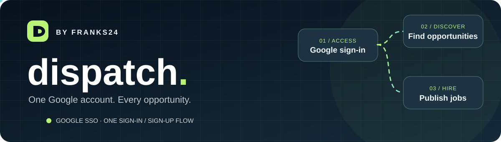
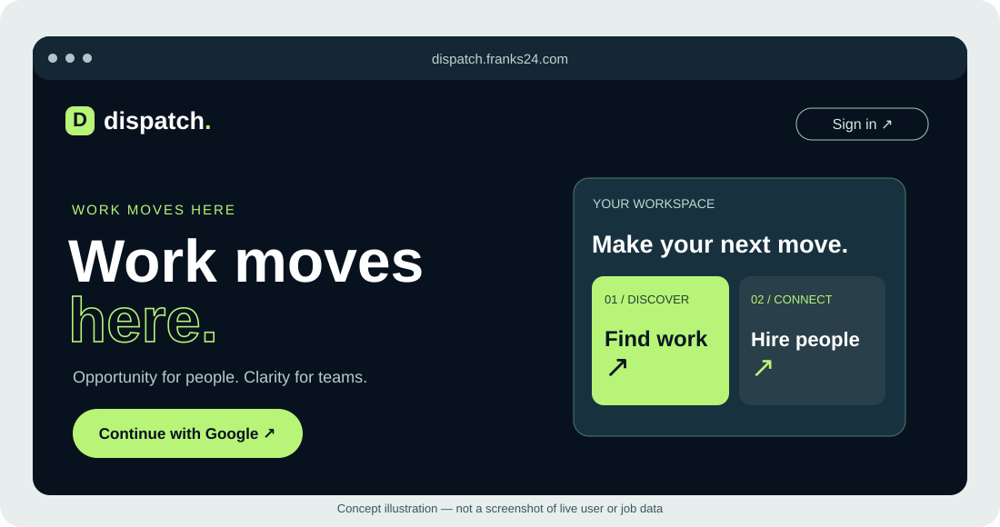
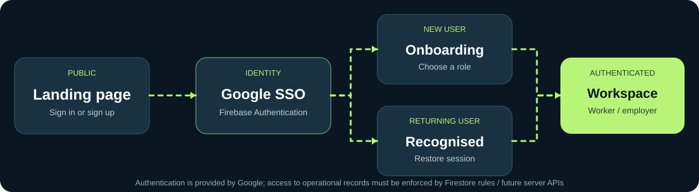
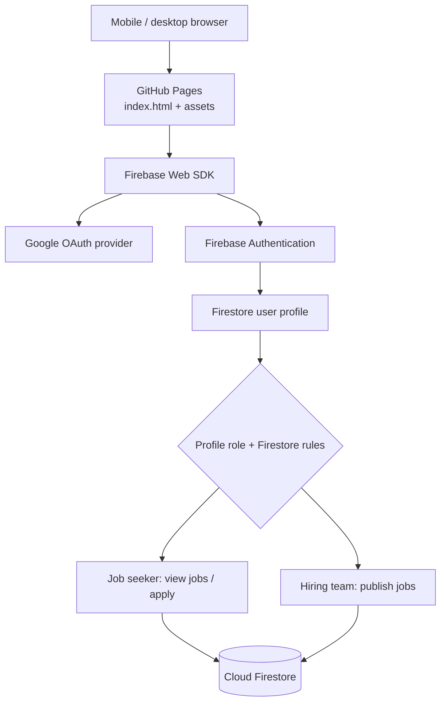

<div align="center">



# Dispatch — by Franks24

**Work moves here. One Google sign-in for everyone.**

[](https://github.com/franks-24/dispatch/actions/workflows/deploy-pages.yml)
[](LICENSE)
[](https://github.com/franks-24/dispatch/commits/main)
[](https://github.com/franks-24/dispatch/issues)
[](https://firebase.google.com/docs/auth/web/google-signin)
[](https://github.com/franks-24/dispatch/settings/pages)
[](#activate-google-sso)

[Production domain](https://dispatch.franks24.com) · [Deployment actions](https://github.com/franks-24/dispatch/actions/workflows/deploy-pages.yml) · [Google authentication docs](https://firebase.google.com/docs/auth/web/google-signin)

</div>

## Overview

**Dispatch** is a responsive platform for connecting people seeking work and organisations hiring them. Visitors use one **Continue with Google** action for both sign-up and sign-in. A first-time visitor completes onboarding as a **job seeker** or **hiring team**; a returning visitor is directed to their role-specific workspace.

The application is a static HTML/CSS/JavaScript frontend hosted using GitHub Pages, with Firebase Authentication for Google identity and Cloud Firestore for user profiles, jobs and applications. **No Vercel deployment is required.**

> **Deployment status:** The GitHub Pages workflow is present and has completed successfully. This does **not** establish that the custom domain resolves everywhere, or that live Google sign-in works. The public Firebase configuration in `assets/config.js` is currently `null`, so real Google SSO **still needs activation**. Never represent the login as active until an end-to-end test succeeds.

<div align="center">

<sub>Concept illustration; no actual users, jobs, or customers are depicted.</sub>
</div>

## Features

| Area | Current implementation |
|---|---|
| Landing page | Responsive dark-navy/lime design, animated accents and one Google entry point |
| Single login / signup | Google-only sign-in through Firebase Authentication; no usernames or local passwords |
| Consent-first onboarding | Animated, mobile-responsive role capture; separate mandatory Terms, Privacy and Data Usage acknowledgments |
| Returning users | Firebase session, profile and current-policy agreement check before workspace access |
| Job seekers | View open listings and apply once per job |
| Hiring teams | Register with Google, await administrator approval, then publish and manage job listings |
| Security rules | Versioned, immutable Google-linked agreement evidence; rule-level gates for profiles, jobs and applications |
| Documentation | Firebase setup, GitHub Pages configuration, deployment requirements and diagrams |
| Visual assets | Original animated SVG README hero, UI illustration and authentication flow diagram |

### Experience and identity flow



```mermaid
flowchart LR
  A[Public landing page] --> B[Continue with Google]
  B --> C[Firebase Google Authentication]
  C --> D{Existing profile?}
  D -->|No| E[First visit: select worker or employer]
  E --> J[Review and accept three policies]\n  J --> F[Record immutable versioned agreement]\n  F --> K[Create protected user profile]
  D -->|Yes| G[Restore profile and check policy acceptance]
  K --> H[Role-specific workspace]
  G --> L{Current agreement exists?}\n  L -->|No| J\n  L -->|Yes| H
  H --> I[Sign out]
  I --> A
```

**One action serves both cases:** the Firebase Google provider creates the account identity on first successful access and signs in the same identity on future visits. A new user completes profile setup after that initial authentication.

## Consent-first onboarding and legal-review gate

The new responsive onboarding experience is an authenticated capture page following **Continue with Google**. Users choose **job seeker** or **hiring team**, enter only the required profile data, and must individually check each of three unticked acknowledgments:

1. [Platform Terms of Use](legal/terms.html) — affirmative contract acceptance.
2. [Privacy Notice](legal/privacy.html) — acknowledgment of a notice, **not** blanket consent to unrelated processing.
3. [Data Ownership & Usage Policy](legal/data-ownership.html) — acknowledgment of content rights and the limited service licence; Dispatch does **not** acquire ownership of user content through onboarding.

The client creates `agreements/{uid}/versions/2026-10-30-v1` with the authenticated Google UID/email, separate boolean acknowledgments, policy version and Firestore server timestamp. **Firestore Security Rules** validate these fields, reject client edits or deletion, and require the current version before creating profiles or accessing jobs and applications. Returning users with old profiles but without the current release must re-acknowledge before accessing the workspace. The app's privacy page clearly identifies processing purposes, rights and retention dependencies. An optional marketing opt-in is **not** bundled into signup.

**Important: the three legal documents are pre-launch drafts, not approved legal instruments.** Before onboarding real people, confirm the responsible legal entity, official support/Information Officer contact, POPIA handling and cross-border safeguards, retention/deletion procedure and counsel's sign-off. Bumping the policy requires updating both `assets/consent-policy.js` and `firestore.rules`, updating legal pages, and running rule tests. Publishing the site does not publish Firestore rules.

**Testing:** `npm run test:onboarding` checks onboarding content and policy version consistency; `npm run test:rules` runs security policy tests in the Firebase Firestore emulator.

## Architecture



**Security boundaries:** Client-side route visibility is not an access-control boundary. Cloud Firestore rules must be published and tested before accepting any production users. Do not put service-account keys, tokens, or other secrets in `assets/config.js` or GitHub Pages. Production readiness additionally requires abuse prevention, moderation, comprehensive privacy controls and documented data deletion/export processes.

## Activate Google SSO

1. Open the [Firebase Console](https://console.firebase.google.com/) and create/select the Dispatch project.
2. Register a **Web app** under project settings; copy its **public Firebase web config** into [`assets/config.js`](assets/config.js). Keep service-account credentials private.
3. Under **Authentication → Sign-in method**, enable **Google** and select a support email.
4. Under **Authentication → Settings → Authorized domains**, authorise **`dispatch.franks24.com`**. Add the GitHub Pages fallback domain only if you intend to use it.
5. Create the production Firestore database and publish the reviewed [`firestore.rules`](firestore.rules). The website deployment does not deploy Firestore rules. **Administrator verification is mandatory** for employer job publishing; approval records are maintained outside the client in `employerApprovals/{uid}`.
6. Test first-time Google onboarding, returning Google login, sign-out, job-seeker access and employer access. Confirm unauthenticated requests are denied.

Official references: [Google sign-in with Firebase](https://firebase.google.com/docs/auth/web/google-signin) · [Firebase authorised domains](https://firebase.google.com/docs/auth/web/redirect-best-practices) · [Cloud Firestore security rules](https://firebase.google.com/docs/firestore/security/get-started).

### Employer verification (Firebase Spark)

Any Google user can onboard as a job seeker or an employer. Employer accounts **cannot publish jobs until a Dispatch administrator verifies the organisation**. The employer sees a pending-verification notice with a **Check status** action. Firestore Security Rules enforce the restriction even for a modified or malicious browser client.

Approvals are held in `employerApprovals/{firebaseAuthUid}`, separate from self-managed profiles. Only privileged Firebase administrators can write them; browser users can read their own status. To approve an employer, confirm the organisation's legitimacy, then create/update the approval document with `status: "approved"` using Firestore Console or Admin SDK. `rejected`, `suspended` or missing approval blocks publishing. Revoked employers may close existing jobs but not reopen them.

**Launch checklist and admin procedure:** [Firebase setup and employer approval](docs/firebase-setup.md).

**Rules tests:** `npm install && npm run test:rules` runs the Firestore emulator tests, including self-approval denial, unverified publishing denial, verified publishing, revoked publishing and worker restrictions. Test workflow runs in GitHub Actions on relevant PRs.

The public Firebase Web SDK settings in `assets/config.js` **must still be supplied**. This pull request does **not** activate live authentication or deploy security rules to `dispatch-1491f` automatically.

### GitHub Pages publishing

The [`deploy-pages.yml`](.github/workflows/deploy-pages.yml) action deploys the static repository on pushes to `main`. In [Settings → Pages](https://github.com/franks-24/dispatch/settings/pages), ensure the publishing source is **GitHub Actions**. The repository `CNAME` specifies `dispatch.franks24.com`; DNS must also point to the configured GitHub Pages host, and HTTPS must be enabled after certificate provisioning.

- [Deployment workflow and live logs](https://github.com/franks-24/dispatch/actions/workflows/deploy-pages.yml)
- [Pages domain configuration](https://docs.github.com/en/pages/configuring-a-custom-domain-for-your-github-pages-site)
- [Firebase web app configuration](https://firebase.google.com/docs/web/setup)

## Repository layout

```text
.
├── index.html                     # Public landing, onboarding and workspace markup
├── assets/
│   ├── app.js                      # Google auth, agreement gating, profile and jobs\n│   ├── consent-policy.js           # Current legal release and storage path\n│   ├── onboarding.css              # Responsive animated capture interface\n│   ├── legal.css                   # Responsive policy document styling
│   ├── config.js                   # Public Firebase web config — needs setup
│   ├── styles.css                  # Responsive styles and motion
│   ├── favicon.svg
│   ├── readme-banner.svg           # Animated brand illustration
│   ├── readme-auth-flow.svg        # Identity flow illustration
│   └── readme-workspace.svg        # Landing page concept illustration
├── legal/                         # Terms, Privacy and Data Usage policy drafts\n├── firestore.rules                 # Agreement and workspace security gates
├── .github/workflows/deploy-pages.yml
├── CNAME                           # Custom domain
├── LICENSE
└── README.md
```

## Local preview

Use any static local web server instead of opening `index.html` directly from `file://` (the app uses ES modules):

```bash
python3 -m http.server 8080
```

Then open `http://localhost:8080`. For real sign-in, register the local host in Firebase Authentication's authorised domains when appropriate and use the project's public web app configuration.

## Accessibility and responsible launch

SVG illustrations include accessible titles/descriptions and support reduced-motion preferences. The application is designed for mobile and desktop screens. Before scaling up, validate keyboard navigation, screen-reader announcements, cross-device login, automated Firestore rule tests, rate limiting, organisation verification for employers and secure audit logging.

---

<div align="center"><strong>Dispatch by Franks24</strong> · Secure Google identity · A single entry point for opportunity and hiring.</div>
