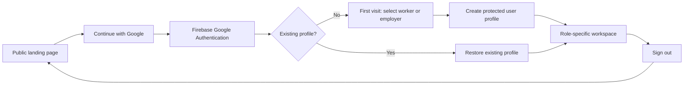
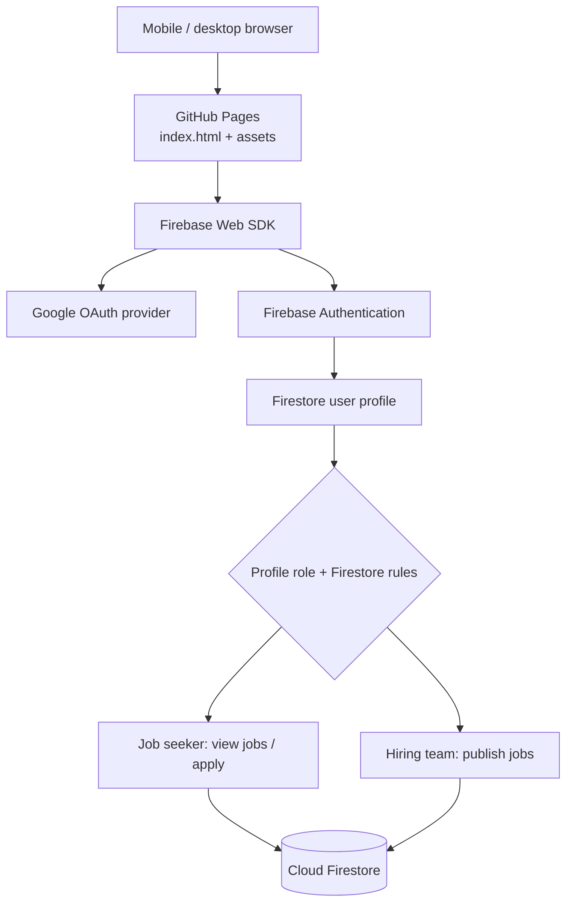

<div align="center">


# Dispatch — by Franks24

**Work moves here. One Google sign-in for everyone.**

[](https://github.com/franks-24/dispatch/actions/workflows/deploy-pages.yml)
[](LICENSE)
[](https://github.com/franks-24/dispatch/commits/main)
[](https://github.com/franks-24/dispatch/issues)
[](https://firebase.google.com/docs/auth/web/google-signin)
[](https://github.com/franks-24/dispatch/settings/pages)
[](#activate-google-sso)

[Production domain](https://dispatch.franks24.com) · [Deployment actions](https://github.com/franks-24/dispatch/actions/workflows/deploy-pages.yml) · [Google authentication docs](https://firebase.google.com/docs/auth/web/google-signin)

</div>

## Overview

**Dispatch** is a responsive platform for connecting people seeking work and organisations hiring them. Visitors use one **Continue with Google** action for both sign-up and sign-in. A first-time visitor completes onboarding as a **job seeker** or **hiring team**; a returning visitor is directed to their role-specific workspace.

The application is a static HTML/CSS/JavaScript frontend hosted using GitHub Pages, with Firebase Authentication for Google identity and Cloud Firestore for user profiles, jobs and applications. **No Vercel deployment is required.**

> **Deployment status:** The HTTPS landing page is reachable, but end-to-end Google SSO has not been verified. The checked-in `assets/config.js` deliberately stays `null`; GitHub Actions generates the public browser configuration at deployment from the repository variable `FIREBASE_WEB_CONFIG_JSON`. Production deployment now fails closed when the variable is missing or targets the wrong project. Google provider, authorized domains, Firestore and rules still require separate verification. Never represent the login as active until an actual Google login succeeds.

<div align="center">

<sub>Concept illustration; no actual users, jobs, or customers are depicted.</sub>
</div>

## Features

| Area | Current implementation |
|---|---|
| Landing page | Responsive dark-navy/lime design, animated accents and one Google entry point |
| Single login / signup | Google-only sign-in through Firebase Authentication; no usernames or local passwords |
| First-time onboarding | Collect name, location, optional details and job-seeker / employer role |
| Returning users | Firebase session observation and profile lookup |
| Job seekers | View open listings and apply once per job |
| Hiring teams | Publish job listings and view own postings |
| Security rules | Source-controlled Firestore rules for profiles, jobs and applications |
| Documentation | Firebase setup, GitHub Pages configuration, deployment requirements and diagrams |
| Visual assets | Original animated SVG README hero, UI illustration and authentication flow diagram |

### Experience and identity flow




**One action serves both cases:** the Firebase Google provider creates the account identity on first successful access and signs in the same identity on future visits. A new user completes profile setup after that initial authentication.

## Architecture



**Security boundaries:** Client-side route visibility is not an access-control boundary. Cloud Firestore rules must be published and tested before accepting any production users. Do not put service-account keys, tokens, or other secrets in `assets/config.js` or GitHub Pages. Production readiness additionally requires abuse prevention, moderation, comprehensive privacy controls and documented data deletion/export processes.

## Activate Google SSO

1. Open the [Firebase Console](https://console.firebase.google.com/) and create/select the Dispatch project.
2. Register/select the existing Firebase Web app and add its **public web configuration JSON** as the GitHub Actions repository variable **`FIREBASE_WEB_CONFIG_JSON`** under [Settings → Secrets and variables → Actions → Variables](https://github.com/franks-24/dispatch/settings/variables/actions). Include `apiKey`, `authDomain`, `projectId`, `storageBucket`, `messagingSenderId`, `appId`, and optional `measurementId`. The [Pages workflow](.github/workflows/deploy-pages.yml) writes the config into the published JavaScript module only after validating the project. Never place service-account credentials or OAuth client secrets in this variable.
3. Under **Authentication → Sign-in method**, enable **Google** and select a support email.
4. Under **Authentication → Settings → Authorized domains**, authorise **`dispatch.franks24.com`**. Add the GitHub Pages fallback domain only if you intend to use it.
5. Create the production Firestore database and publish the reviewed [`firestore.rules`](firestore.rules). The website deployment does not deploy Firestore rules.
6. Test first-time Google onboarding, returning Google login, sign-out, job-seeker access and employer access. Confirm unauthenticated requests are denied.

Official references: [Google sign-in with Firebase](https://firebase.google.com/docs/auth/web/google-signin) · [Firebase authorised domains](https://firebase.google.com/docs/auth/web/redirect-best-practices) · [Cloud Firestore security rules](https://firebase.google.com/docs/firestore/security/get-started).

### GitHub Pages publishing

The [`deploy-pages.yml`](.github/workflows/deploy-pages.yml) action deploys the static repository on pushes to `main`. In [Settings → Pages](https://github.com/franks-24/dispatch/settings/pages), ensure the publishing source is **GitHub Actions**. The repository `CNAME` specifies `dispatch.franks24.com`; DNS must also point to the configured GitHub Pages host, and HTTPS must be enabled after certificate provisioning.

- [Deployment workflow and live logs](https://github.com/franks-24/dispatch/actions/workflows/deploy-pages.yml)
- [Pages domain configuration](https://docs.github.com/en/pages/configuring-a-custom-domain-for-your-github-pages-site)
- [Firebase web app configuration](https://firebase.google.com/docs/web/setup)

## Repository layout

```text
.
├── index.html                     # Public landing, onboarding and workspace markup
├── assets/
│   ├── app.js                      # Google auth, profile, jobs and applications
│   ├── config.js                   # Unconfigured in Git; generated for deployment by CI
│   ├── styles.css                  # Responsive styles and motion
│   ├── favicon.svg
│   ├── readme-banner.svg           # Animated brand illustration
│   ├── readme-auth-flow.svg        # Identity flow illustration
│   └── readme-workspace.svg        # Landing page concept illustration
├── tools/write-firebase-config.mjs # CI: validates and generates public Firebase config
├── firestore.rules                 # Firebase data-access policy
├── .github/workflows/deploy-pages.yml
├── CNAME                           # Custom domain
├── LICENSE
└── README.md
```

## Local preview

Use any static local web server instead of opening `index.html` directly from `file://` (the app uses ES modules):

```bash
python3 -m http.server 8080
```

Then open `http://localhost:8080`. For local Google sign-in testing, create a local `assets/config.js` using the public Firebase Web config (do not commit it), and register the test host in Firebase Authentication's authorised domains. This static deployment imports Firebase directly in the browser: `npm install firebase` and a bundler are **not** required for the production page. `npm run test:config` validates the deployment generator.

## Accessibility and responsible launch

SVG illustrations include accessible titles/descriptions and support reduced-motion preferences. The application is designed for mobile and desktop screens. Before scaling up, validate keyboard navigation, screen-reader announcements, cross-device login, automated Firestore rule tests, rate limiting, organisation verification for employers and secure audit logging.

---

<div align="center"><strong>Dispatch by Franks24</strong> · Secure Google identity · A single entry point for opportunity and hiring.</div>
